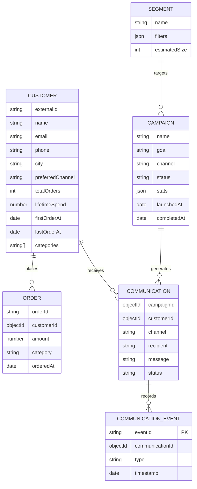

# CampaignPilot 🚀
### AI-Native Shopper Engagement CRM · Autonomous Pipeline with Channel Simulation

> **"Tell it what you want to achieve. It finds the shoppers, builds the campaign, simulates delivery, and explains the results."**

[](https://nodejs.org/)
[](https://react.dev/)
[](https://vitejs.dev/)
[](https://tailwindcss.com/)
[](https://www.mongodb.com/)
[](https://groq.com/)
[](https://zod.dev/)
[](https://opensource.org/licenses/MIT)

---

## 📌 Table of Contents
1. [The Problem It Solves](#-the-problem-it-solves)
2. [Product Overview & Capabilities](#-product-overview--capabilities)
3. [System Architecture](#-system-architecture)
4. [Software Engineering & Defensibility Decisions](#-software-engineering--defensibility-decisions)
5. [The Golden Path (End-to-End Walkthrough)](#-the-golden-path-end-to-end-walkthrough)
6. [Repository Structure](#-repository-structure)
7. [Tech Stack](#-tech-stack)
8. [Configuration & Environment Variables](#-configuration--environment-variables)
9. [Local Development Setup](#-local-development-setup)
10. [Database Design & Seed Strategy](#-database-design--seed-strategy)
11. [API Contract Specifications](#-api-contract-specifications)
12. [Automated Test Suite](#-automated-test-suite)
13. [Production Deployment Guide](#-production-deployment-guide)

---

## 💡 The Problem It Solves

Modern e-commerce and retail marketing teams face three critical friction points in customer relationship management (CRM):

1. **Complex Querying Bottleneck**: Marketers wanting to re-engage dormant or high-value shoppers must either wait for data engineering tickets or navigate cumbersome UI filter trees with dozens of nested boolean logic gates.
2. **Channel & Incentive Guesswork**: Deciding whether to reach customers via WhatsApp, SMS, or Email—and choosing between percentage discounts vs. voucher coupons—is often done by intuition rather than data-driven recommendations.
3. **Black-Box Message Delivery & Attribution**: Traditional mock testing tools either succeed 100% of the time or lack realistic asynchronous delivery stages (Sent → Delivered → Opened/Read → Clicked), preventing teams from testing real-world drop-offs, webhook retries, and attribution math before spending actual messaging budgets.

### The CampaignPilot Solution:
CampaignPilot acts as an **AI-driven co-pilot for shopper engagement**:
* **Natural-Language Understanding**: The marketer types what they want in plain English (e.g., *"Bring back shoppers inactive for 60+ days who spent > ₹2,000"*).
* **Deterministic Execution**: An LLM translates the intent into structured JSON filter parameters, and the backend deterministically executes native MongoDB queries to find exact matching customers.
* **Intelligent Strategy & Copywriting**: Groq AI proposes the optimal messaging channel, discount value, and copywriting tone, personalizing the copy dynamically for each customer (`{{first_name}}`, `{{coupon_code}}`, `{{discount}}`).
* **Realistic Asynchronous Delivery Simulation**: A decoupled simulator service accepts dispatch batches immediately with `202 Accepted`, then simulates realistic drop-offs and fires webhook events back to the CRM.
* **Idempotent Real-Time Analytics**: An event processor updates campaign funnels without risk of double-counting, computes simulated 7-day conversion attribution, and provides post-campaign AI analysis.

---

## 🧭 System Architecture

CampaignPilot is designed as a **clean multi-service monorepo** consisting of three independent units communicating exclusively over HTTP contracts:

```
┌────────────────────────────────────────────────────────────────────────┐
│                   1. Frontend Dashboard (React / Vite)                 │
│      AI Command Center • Audience Explorer • Builder • Live Funnel     │
└───────────────────────────────────┬────────────────────────────────────┘
                                    │ HTTP REST
                                    ▼
┌────────────────────────────────────────────────────────────────────────┐
│                   2. CRM Backend Engine (Node / Express)               │
│  ├── ai.service             → Groq API (Strict Zod-Validated JSON)     │
│  ├── segmentation.service   → Deterministic Mongo queries & proofs     │
│  ├── campaign.service       → Explicit State Machine Orchestrator      │
│  ├── personalization.service→ Per-customer token rendering             │
│  ├── communication.service  → Materialized Communications & states     │
│  ├── channel.service        → HTTP dispatch client to Simulator        │
│  ├── attribution.service    → 7-Day click-to-order heuristic           │
│  └── analytics.service      → Real-time funnel read model              │
└──────────────┬──────────────────────────────────────────▲──────────────┘
               │ POST /api/send                           │
               │ (Immediate 202)                          │ POST /api/webhooks/channel-events
               ▼                                          │ (Idempotent by eventId)
┌─────────────────────────────────────────────────────────┴──────────────┐
│             3. Standalone Channel Simulator (Node / Express)           │
│   Stateless mock provider for WhatsApp, SMS, Email, and RCS            │
│   • Asynchronous setTimeout lifecycle progression                      │
│   • Realistic drop-off probability gates per channel                   │
│   • Resilient webhook client with automatic retry                      │
└────────────────────────────────────────────────────────────────────────┘
```

---

## 🛡️ Software Engineering & Defensibility Decisions

When defending this architecture in an engineering review or interview, these are the core design lines:

### 1. The LLM Never Touches the Database Directly
* **Why**: Granting an LLM direct SQL/Mongo access introduces severe injection risks, hallucinated queries, slow unbounded table scans, and unpredictable mutations.
* **How We Do It**: The LLM receives only a constrained context object, returns structured JSON strictly validated by **Zod schemas**. The backend executes native, indexed MongoDB queries deterministically. If validation fails, it triggers the fallback engine instead of failing.

### 2. Why No Vector DB / RAG (Retrieval-Augmented Generation)?
* **Why**: CRM shopper records are structured, relational, and transactional (order dates, spend totals, order counts, categories). A vector database introduces high query latency, probabilistic similarity errors, and synchronization overhead for data that is natively queried in sub-milliseconds using compound B-Tree database indexes.

### 3. Why No Autonomous Agent Frameworks (LangChain, AutoGen)?
* **Why**: Shopper marketing follows an explicit, well-defined operational pipeline (`Goal → Audience → Strategy → Message → Launch → Simulated Delivery → Analytics`). Autonomous agent loops often hallucinate, get stuck in infinite execution loops, and are difficult to test and audit. A deterministic finite-state machine provides 100% testability, transparency, and sub-second predictability.

### 4. Deterministic Fallback Mode
* If `GROQ_API_KEY` is missing, expired, or rate-limited, the system seamlessly routes requests through deterministic keyword rule engines (`usedFallback: true`). The golden path never breaks.

### 5. Genuine Microservice Decoupling
* The **Channel Simulator** is an entirely separate service running in its own process and port (`:5001`), with its own `package.json` and zero shared imports with the CRM backend. It models third-party messaging aggregators (e.g., Twilio, Gupshup, SendGrid).

### 6. Database-Enforced Webhook Idempotency
* Network timeouts frequently lead to webhook retries. To guarantee that delivery metrics and attribution never double-count, the CRM enforces a **unique database index on `eventId`**. Duplicate event payloads are detected at the database layer and acknowledged safely with HTTP 200 without reprocessing.

---

## ⚡ The Golden Path (End-to-End Walkthrough)

```
Natural-Language Intent
  → AI interprets intent (Groq + Zod, with deterministic fallback)
  → Backend computes real audience from MongoDB (Deterministic)
  → AI recommends channel / offer / tone (Backend validates)
  → AI generates personalized message copy (Rendered per-customer)
  → Campaign created (DRAFT) → Launched (QUEUED → SENDING)
  → CRM Backend calls Channel Simulator (POST /api/send)
  → Channel Simulator acknowledges immediately (202 Accepted)
  → Channel Simulator asynchronously progresses lifecycle:
      WhatsApp / RCS: accepted → delivered → read → clicked
      SMS:            accepted → delivered → clicked
      Email:          accepted → delivered → opened → clicked
      (with realistic drop-offs and occasional failures)
  → Simulator calls CRM Webhook (POST /api/webhooks/channel-events)
  → CRM processes event idempotently, updates Communication + Campaign stats
  → Analytics dashboard renders live funnel + 7-day simulated attribution
  → AI Campaign Analyst summarizes results + suggests next action
```

---

## 📂 Repository Structure

```
CampaignPilot/
├── backend/                       # CRM Backend Service (Port 5000)
│   ├── src/
│   │   ├── config/                # Mongoose database connection
│   │   ├── controllers/           # Thin request/response handlers
│   │   ├── middleware/            # Centralized error handling & 404
│   │   ├── models/                # Customer, Order, Segment, Campaign, etc.
│   │   ├── routes/                # REST endpoints
│   │   ├── seed/                  # Realistic synthetic shopper generator
│   │   ├── services/              # Segmentation, AI, Campaign, Webhook logic
│   │   ├── utils/validators/      # Zod validation schemas
│   │   ├── test_sections_2_5.js   # Unit & service integration tests
│   │   ├── test_e2e_full.js       # Complete Golden Path automated test
│   │   ├── test_http_services.js  # Live dual-service HTTP verification test
│   │   └── app.js                 # Express app assembly
│   ├── .env.example
│   └── package.json
│
├── channel-service/               # Standalone Channel Simulator (Port 5001)
│   ├── src/
│   │   ├── routes/                # POST /api/send & GET /api/health
│   │   ├── services/              # Async lifecycle simulation & webhook client
│   │   ├── app.js                 # Express app assembly
│   │   └── server.js              # Server entry point
│   ├── .env.example
│   └── package.json
│
├── frontend/                      # React SPA Dashboard (Port 3000 / 5173)
│   ├── src/
│   │   ├── api/                   # Modular Axios API clients
│   │   ├── components/            # Reusable UI primitives & layouts
│   │   ├── context/               # Non-blocking Toast notification provider
│   │   ├── layouts/               # Shared sidebar, navigation & system status
│   │   ├── pages/                 # Dashboard, Customers, Segments, Builder, Analytics
│   │   ├── App.jsx                # React Router v6 route assembly
│   │   └── main.jsx               # React entry point
│   ├── .env.example
│   ├── tailwind.config.js
│   ├── vite.config.js
│   └── package.json
│
├── .gitignore
├── package.json                   # Root workspace scripts
└── README.md                      # Complete system documentation
```

---

## 🛠️ Tech Stack

| Layer | Technologies | Rationale |
|---|---|---|
| **Frontend** | React 18, Vite 5, Tailwind CSS, React Router v6, Recharts, Lucide Icons | Fast compile times, responsive dark-glass UI, declarative routing, live Recharts funnel polling. |
| **CRM Backend** | Node.js, Express, Mongoose 8, Zod, Groq SDK, Axios | Lightweight async I/O, schema-enforced validation, fast structured LLM inference. |
| **Channel Simulator**| Node.js, Express, Axios, UUID | Completely independent mock messaging engine simulating real-world drop-offs. |
| **Database** | MongoDB (Local or MongoDB Atlas) | Flexible document store ideal for customer profiles, order history, and polymorphic event logs. |
| **LLM Inference** | Groq API (`llama-3.3-70b-versatile`) | Ultra-fast token generation for real-time interactive UI experiences with strict JSON schema outputs. |

---

## ⚙️ Configuration & Environment Variables

### 1. `backend/.env`
```env
PORT=5000
MONGODB_URI=mongodb://localhost:27017/campaignpilot # Or MongoDB Atlas connection string
GROQ_API_KEY=gsk_your_groq_api_key_here             # Optional: triggers deterministic fallback if omitted
CHANNEL_SERVICE_URL=http://localhost:5001
WEBHOOK_SECRET=campaignpilot_webhook_secret_2026
CLIENT_ORIGIN=http://localhost:3000
SEED_CUSTOMERS=500                                 # Configurable seed size (default 500, uses ~1.8MB on Atlas)
```

### 2. `channel-service/.env`
```env
PORT=5001
CRM_WEBHOOK_URL=http://localhost:5000/api/webhooks
```

### 3. `frontend/.env`
```env
VITE_API_BASE_URL=http://localhost:5000/api
VITE_CHANNEL_SERVICE_URL=http://localhost:5001/api
```

---

## 🚀 Local Development Setup

### Prerequisites
* Node.js v18.0.0 or higher
* MongoDB (running locally or MongoDB Atlas)

### Step 1: Install Dependencies
```bash
# Clone the repository
git clone https://github.com/your-username/CampaignPilot.git
cd CampaignPilot

# Install dependencies in all services
npm --prefix backend install
npm --prefix channel-service install
npm --prefix frontend install
```

### Step 2: Configure Environment Files
Copy the example files and update any keys:
```bash
cp backend/.env.example backend/.env
cp channel-service/.env.example channel-service/.env
cp frontend/.env.example frontend/.env
```

### Step 3: Seed the Database
Populate realistic shopper profiles and order histories:
```bash
npm run seed
```
*(Creates 500 customers and ~2,600 orders across 5 behavioral archetypes in < 5 seconds).*

### Step 4: Run All Services
Open three separate terminals:

```bash
# Terminal 1: CRM Backend API (Port 5000)
cd backend && npm run dev

# Terminal 2: Channel Simulator (Port 5001)
cd channel-service && npm run dev

# Terminal 3: Frontend Dashboard (Port 3000)
cd frontend && npm run dev
```

Visit **`http://localhost:3000`** in your browser.

---

## 📊 Database Design & Seed Strategy

The platform models customer behavioral data across 6 primary collections:



### Intentional Shopper Archetypes:
* **High-Value Loyal** (~20%): Frequent purchases, lifetime spend > ₹5,000.
* **Dormant / Inactive** (~25%): 60 to 180+ days since last order, past spend > ₹2,000.
* **New Shoppers** (~20%): 1 order placed within the last 14 days.
* **Frequent-Low-Spend** (~15%): 5–10 orders with small ticket sizes (< ₹400).
* **Category-Loyal** (~20%): Shoppers concentrated strictly in one department (Fashion, Beauty, Tech).

---

## 📡 API Contract Specifications

### CRM Backend (`http://localhost:5000/api`)

| Method | Endpoint | Description |
|---|---|---|
| `GET` | `/health` | Service health check |
| `GET` | `/customers` | Paginated customer list with city/channel/category filters |
| `GET` | `/customers/:id` | Detailed shopper profile with campaign touchpoints |
| `GET` | `/customers/:id/orders` | Customer order timeline |
| `POST`| `/segments/preview` | Deterministic audience size and inclusion proofs |
| `POST`| `/segments` | Save named segment |
| `GET` | `/segments` | Fetch all saved segments |
| `POST`| `/ai/interpret-intent` | Parse natural language intent into structured filters |
| `POST`| `/ai/recommend-campaign`| AI-suggested channel, offer, and copywriting tone |
| `POST`| `/ai/generate-message` | Personalize copy with merge token validation |
| `POST`| `/ai/analyze-campaign` | Post-campaign AI analysis based on funnel stats |
| `POST`| `/campaigns` | Create campaign in `DRAFT` status |
| `GET` | `/campaigns` | List all campaigns |
| `GET` | `/campaigns/:id` | Campaign details |
| `POST`| `/campaigns/:id/launch` | Launch campaign and dispatch to simulator |
| `GET` | `/campaigns/:id/analytics`| Real-time funnel counts, 7-day attribution & AI insight |
| `POST`| `/webhooks/channel-events`| Idempotent callback endpoint for simulator events |
| `GET` | `/analytics/overview` | Platform-level stats for dashboard overview |

### Channel Simulator (`http://localhost:5001/api`)

| Method | Endpoint | Description |
|---|---|---|
| `GET` | `/health` | Simulator status & webhook target verification |
| `POST`| `/send` | Accept dispatch request, return `202 Accepted` immediately |

---

## 🧪 Automated Test Suite

CampaignPilot includes automated verification scripts that test the entire pipeline:

```bash
# 1. Test Segmentation, Personalization, and AI Fallback Modes
node backend/src/test_sections_2_5.js

# 2. Test Full End-to-End Pipeline & Webhook Idempotency (Replay Attack)
node backend/src/test_e2e_full.js

# 3. Test Live Dual-Service HTTP Communication (Port 5000 ↔ Port 5001)
node backend/src/test_http_services.js

# 4. Verify Frontend Production Build
npm --prefix frontend run build
```

---

## 🌐 Production Deployment Guide

### 1. Database (MongoDB Atlas)
* Create a free **M0 Cluster** on [MongoDB Atlas](https://www.mongodb.com/cloud/atlas).
* Under **Network Access**, allow access from anywhere (`0.0.0.0/0`).
* Copy your connection string into `backend/.env`.

### 2. CRM Backend & Channel Simulator (Render / Railway)
* **Backend Service**:
  * Build Command: `npm install`
  * Start Command: `node src/index.js`
  * Environment Variables: `MONGODB_URI`, `GROQ_API_KEY`, `CHANNEL_SERVICE_URL`, `CLIENT_ORIGIN`.
* **Channel Simulator Service**:
  * Build Command: `npm install`
  * Start Command: `node src/server.js`
  * Environment Variables: `PORT=5001`, `CRM_WEBHOOK_URL=https://<your-backend>.onrender.com/api/webhooks`.

### 3. Frontend (Vercel)
* Framework Preset: **Vite**
* Root Directory: `frontend`
* Build Command: `npm run build`
* Output Directory: `dist`
* Environment Variables: `VITE_API_BASE_URL=https://<your-backend>.onrender.com/api`.

---

## 🎬 5-Minute Evaluation Demo Walkthrough

1. **Dashboard (0:00 - 0:45)**:
   * View live seeded KPI cards.
   * Click prompt chip: *"Bring back customers who haven't purchased in the last 60 days and previously spent more than ₹2,000"*.
   * Click **Build Campaign**.
2. **Deterministic Audience Evaluation (0:45 - 1:30)**:
   * Observe intent parsed into deterministic Mongo filters (`daysSinceLastOrder >= 60`, `lifetimeSpend >= 2000`).
   * Review matched shopper count and inspect deterministic **Inclusion Proofs**.
3. **Strategy & Message Personalization (1:30 - 2:30)**:
   * Review AI channel recommendation (WhatsApp), offer (20% OFF), and tone.
   * View personalized copy rendered for 3 real shoppers with their actual names and coupon codes.
4. **Launch & Asynchronous Delivery (2:30 - 3:45)**:
   * Click **Launch Campaign Now**.
   * Watch live polling on the Campaign Analytics page as the Channel Simulator asynchronously streams events back.
   * Watch funnel bars (**Sent → Delivered → Opened/Read → Clicked**) climb in real time.
5. **Insights & Attribution (3:45 - 5:00)**:
   * Inspect simulated 7-day attribution metrics.
   * Read the **AI Campaign Analyst** report breakdown (Summary, Patterns, Bottlenecks, and Recommended Next Action).

---

## 📄 License
MIT © 2026 CampaignPilot.
